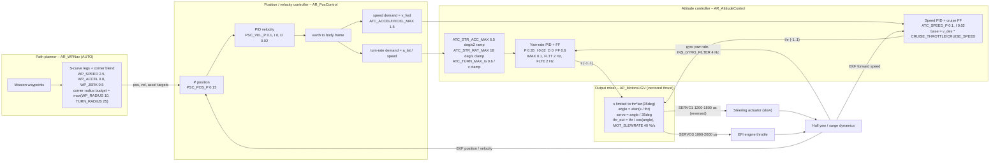
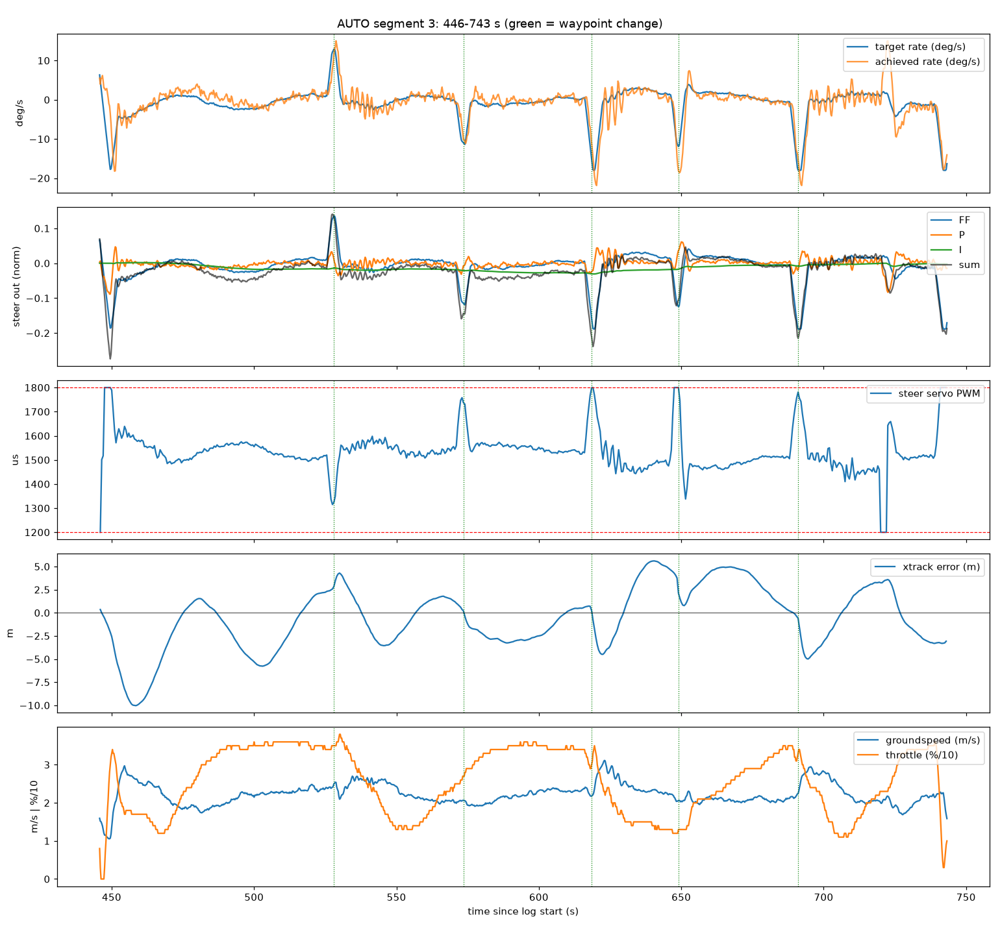
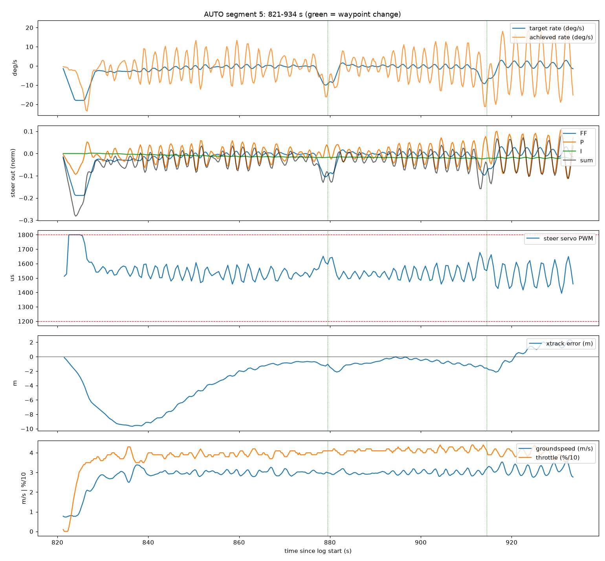
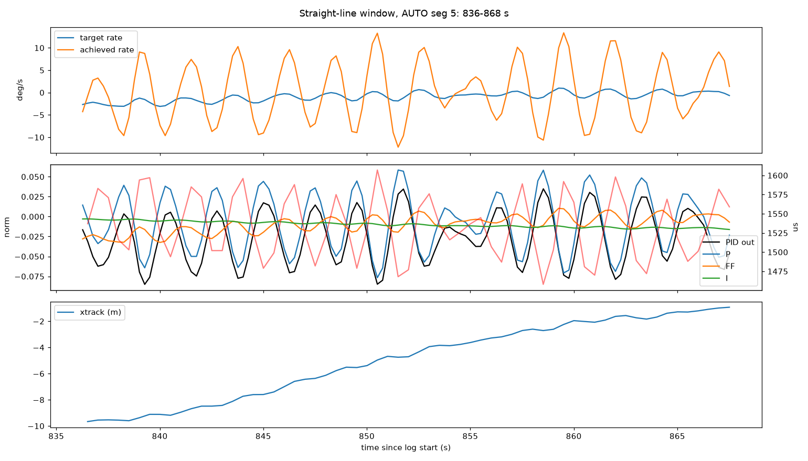
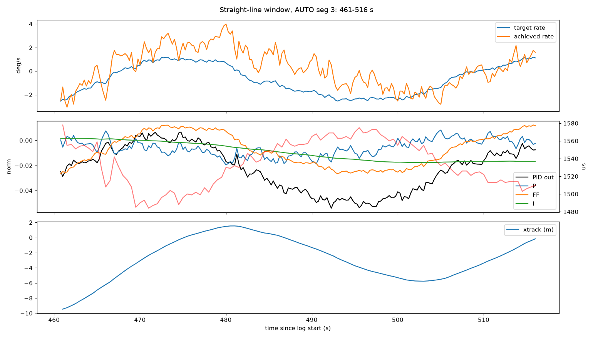

# AquaDrone steering control – architecture and log analysis

Vehicle: large RC boat, ArduRover **V4.6.3** (CUAV‑X7), FRAME_CLASS=2 (boat), vectored thrust (MOT_VEC_ANGLEMAX=35), EFI combustion engine.
Inputs analysed: `2026-10-01 11-33-21.tlog` (1391 s, 4 AUTO runs, 5 MANUAL runs) and `AquaDrone bt5.param`.
Reproduce: `.venv/bin/python tools/analyze_rover_tlog.py "2026-10-01 11-33-21.tlog" --out docs/img` (full text output in [docs/img/analysis_output.txt](img/analysis_output.txt)).

> **Config mismatch warning.** The parameters streamed in the log and the saved `.param` file are *not* the same configuration: AHRS_ORIENTATION 0 vs 30, COMPASS_USE2 1 vs 0, CRUISE_SPEED 2.95 vs 1.30 m/s, CRUISE_THROTTLE 26 vs 31 %, WP_SPEED 2.5–3.0 (changed during the session) vs 2.2. All steering, position-controller and navigation gains are identical, so the steering conclusions transfer; the speed-loop remarks need re-checking on the current boat.

---

## 1. Control loop architecture (CLA)

Yes – with `SERVO1_FUNCTION=26` (GroundSteering), `SERVO3_FUNCTION=70` (Throttle) and `MOT_VEC_ANGLEMAX=35`, Rover treats the boat as **vectored thrust**. The *controllers* for heading and speed are separate loops, but they are coupled in the output mixer: steering authority scales with 1/throttle and throttle is boosted by 1/cos(steering angle). Everything below runs at `SCHED_LOOP_RATE` = 50 Hz.

### 1.1 Loop by loop (Rover‑4.6.3 source: `AR_WPNav.cpp`, `AR_PosControl.cpp`, `AR_AttitudeControl.cpp`, `AP_MotorsUGV.cpp`)

| Loop | What it does | Parameters that matter here |
|---|---|---|
| **Path planner** (S-curve) | Generates a position/velocity/acceleration target that moves along each leg at `WP_SPEED`, accelerating with `WP_ACCEL`/`WP_JERK`. At a “fast” waypoint the next leg is started while the current one decelerates, so the target *blends* around the corner; the blend is allowed when the predicted apex is within `max(WP_RADIUS, TURN_RADIUS)` of the waypoint and the predicted acceleration there is below `ATC_TURN_MAX_G·g`. In a 90° blend the two legs each contribute `WP_ACCEL`, so at mid-corner the target moves at `WP_SPEED/√2` with `√2·WP_ACCEL` of centripetal acceleration: **planned peak turn rate ≈ 2·WP_ACCEL / WP_SPEED**, mid-corner radius ≈ 0.35·WP_SPEED²/WP_ACCEL. | WP_SPEED, WP_ACCEL, WP_JERK, WP_RADIUS, TURN_RADIUS, ATC_TURN_MAX_G |
| **Position / velocity** | `vel_target = PSC_POS_P·pos_error + vel_desired`; `accel_target = PID_vel(vel_target − vel) + accel_desired`. The lateral component becomes a **turn-rate demand** `ω = a_lat / speed`; the forward component becomes the **speed demand**. Velocity I‑term is zeroed in the forward direction. | PSC_POS_P, PSC_VEL_P/I/D, ATC_TURN_MAX_G (via `turn_speed_min`) |
| **Yaw-rate (steering) loop** | Demand is ramped by `ATC_STR_ACC_MAX`, clamped by `ATC_STR_RAT_MAX` and by `ATC_TURN_MAX_G·g / speed`, then `out = FF·ω_des + P·e + I·∫e + D·ė` with `e = ω_des − gyro_z`. Target and error pass through 2 Hz low‑pass filters (`FLTT`, `FLTE`). I‑term is frozen while the mixer reports a steering limit. | ATC_STR_RAT_P/I/D/FF/IMAX, FLTT/FLTE, ACC_MAX, RAT_MAX |
| **Speed loop** | `thr = v_des·(CRUISE_THROTTLE/CRUISE_SPEED) + P·(v_des − v) + I·∫(…)`; demand slewed by `ATC_ACCEL_MAX`/`DECEL_MAX`. | CRUISE_*, ATC_SPEED_P/I/IMAX, ATC_ACCEL_MAX |
| **Vectored-thrust mixer** | Interprets the steering output `s` as *lateral thrust fraction*: `abs(s) ≤ thr·tan(35°)`, `angle = atan(s/thr)`, `servo = angle/35°`, `thr_out = thr/cos(angle)`. Small-angle: **servo ≈ 1.64·s/thr**, i.e. the servo deflection per unit PID output is ≈ 4.4 at 37 % throttle, 6.3 at 26 %, 12.6 at 13 %. This is physically sensible (lateral force ≈ T·sin δ ∝ thr·δ, so the loop gain to lateral force stays ~constant), but it means (a) the available steering output saturates at `s = thr·tan 35°` (= 0.18 at 26 % throttle) and (b) throttle dips raise the steering gain. Measured in the log: servo/PID‑out ratio 2.75 / 5.37 / 4.10 / 3.79 in the four AUTO runs vs 2.53 / 4.42 / 3.54 / 3.37 predicted from the median throttle. | MOT_VEC_ANGLEMAX, SERVO1_MIN/MAX/TRIM (must correspond to ±35° physically) |
| **Actuator + hull** | From the MANUAL runs (open loop): yaw‑rate response lags the servo command by **0.5–1.5 s** (cross-correlation), steady gain **16–25 deg/s per full servo deflection** (rising with speed: 1.2 m/s → 16, 3.3–3.8 m/s → 19–24, 5.8 m/s → 25). Yaw‑rate capability at > 1.5 m/s: 99th percentile 22 deg/s, max 28 deg/s. | — |

---

## 2. What the log shows

Segment overview (AUTO segments in bold; `sat%` = fraction of time the steering servo was at 1200/1800 µs, `xtrk_rms` in m):

| seg | mode | start s | dur s | speed m/s | thr % | rate err rms deg/s | out rms | P rms | I rms | FF rms | sat % | xtrk rms |
|---|---|---|---|---|---|---|---|---|---|---|---|---|
| **1** | AUTO | 239 | 17 | 2.98 | 62.7 | 6.50 | 0.147 | 0.040 | 0.004 | 0.112 | 22.6 | 21.8 |
| **3** | AUTO | 446 | 298 | 2.23 | 25.8 | 2.51 | 0.052 | 0.015 | 0.016 | 0.043 | 3.4 | 3.43 |
| **5** | AUTO | 821 | 113 | 2.94 | 39.5 | 6.98 | 0.065 | 0.042 | 0.016 | 0.042 | 1.8 | 4.07 |
| **7** | AUTO | 1158 | 66 | 2.58 | 37.6 | 7.16 | 0.122 | 0.043 | 0.010 | 0.093 | 17.8 | 5.81 |

### 2.1 Inner-loop limit cycle at ≈0.43 Hz – the “nervous” straight-line behaviour

* On the straight leg of segment 5 (3.0 m/s, 39 % throttle) the achieved yaw rate oscillates **±10 deg/s with a 2.3 s period (0.43–0.45 Hz)** while the demanded rate is flat at −2…+1 deg/s. The P term swings ±0.05, the servo ±60 µs (≈ ±7° of thruster angle). Near 920–933 s (3.15 m/s) the amplitude grows to ±19 deg/s – the loop is at or beyond its stability limit.
* Yaw‑rate energy in the 0.25–0.8 Hz band: **MANUAL 0.7–1.5 deg/s rms** (hull + waves) vs **AUTO seg 5/7 4.4–4.5 deg/s rms** with a clear 0.43 Hz peak. In segment 3 (2.2 m/s, 26 %) the band rms is 0.8–1.4 deg/s – the same oscillation appears after each corner but decays. The oscillation is therefore **controller-induced and speed/throttle dependent**.
* Steering command → yaw‑rate lag in closed loop: 1.0 s (corr 0.92). A ~1 s effective dead time (actuator travel + hull) alone produces −155° of phase at 0.43 Hz; FLTE 2 Hz adds −12°, INS_GYRO_FILTER 4 Hz −6°, hull lag the rest. **The phase crossover is set by the actuator delay; the only lever is loop gain** (and not adding more lag).
* `ATC_STR_RAT_SMAX = 9` does nothing: the observed P+D slew rate is 0.13/s (max 0.43/s), far below the limit.

### 2.2 Slow weave (≈45–50 s period) – outer loop under-damped

* On the straight legs of segment 3 the cross-track error swings −9.5 → +1.5 → −5.7 → +4 m with zero crossings at 475, 487, 516 s, i.e. a **45–50 s period**.
* With a perfect inner loop the lateral dynamics are `ë + PSC_VEL_P·ė + PSC_VEL_P·PSC_POS_P·e = 0`: ωₙ = √(0.1·0.15) = 0.122 rad/s → **51 s period**, ζ = 0.1/(2·0.122) = **0.41**. The measurement matches: the weave is the position/velocity loop itself, not the rate loop. `PSC_VEL_P = 0.1` is 10× below the Rover default (1.0) and provides too little damping relative to `PSC_POS_P`.

### 2.3 Corners – planner asks for exactly the rate limit

| seg | t s | wp | heading change | target max | achieved max | servo min/max µs | sat s | xtrack max m | settle s (<2 m) |
|---|---|---|---|---|---|---|---|---|---|
| 3 | 528 | 2 | +10° | 12.9 | 15.0 | 1324 / 1598 | 0 | 4.3 | 6.5 |
| 3 | 574 | 3 | −30° | 11.4 | 11.2 | 1534 / 1737 | 0 | 4.5 | 54 |
| 3 | 619 | 4 | −47° | **18.0** | **21.9** | 1443 / **1800** | 1.0 | 5.6 | 31 |
| 3 | 649 | 5 | −24° | 11.9 | 18.6 | 1338 / **1800** | 0.5 | 5.0 | 54 |
| 3 | 691 | 6 | −77° | **18.0** | **21.9** | 1410 / 1781 | 0 | 5.0 | 11.5 |
| 7 | 1211 | 4 | −89° | 10.0 | 21.8 | 1396 / **1800** | 2.0 | 5.7 | – |

* The S-curve blends the two legs with `WP_ACCEL = 0.8 m/s²` each; at mid-corner the target runs at `WP_SPEED/√2 ≈ 1.8 m/s` with `√2·0.8 = 1.13 m/s²` of centripetal acceleration, i.e. a **planned peak turn rate of 2·0.8/2.5 = 0.64 rad/s ≈ 37 deg/s – twice `ATC_STR_RAT_MAX`** (18 deg/s even at the start/end of the blend, mid-corner radius ≈ 2.8 m). The position controller passes this on, is clamped at 18 deg/s (0.5–1.2 s per corner in the log), the servo hits its end stop (I‑term freezes), the achieved rate overshoots to 22 deg/s because FF+P were already saturating, and the boat exits the corner 5–6 m off track, taking 30–50 s to settle (the weave of §2.2).
* `ATC_TURN_MAX_G = 0.6` (5.9 m/s²) is far above anything the hull can do, but here it is harmless: it only clamps `turn_rate_max = 5.9/v` (never active) and gates the corner blend (`1.13 < 5.9`, always allowed). Lowering it *below* `√2·WP_ACCEL/g` would delay the blend and make the corner sharper and slower – the opposite of what is wanted for a turn-rate-limited boat – so it should stay well above that threshold. `TURN_RADIUS = 25 m` only bounds how far the apex may be from the waypoint (never active for these corners).

### 2.4 Integral action is ineffective

`ATC_STR_RAT_I = 0.02` with `IMAX = 0.1`: in the straight-leg plot the achieved rate sits 1–2 deg/s above the target for 15–20 s (480–500 s) while the I term creeps at 0.0005/s. The trim offset the boat needs to run straight (−0.02…−0.03 output) is being supplied by P, i.e. by a standing rate error.

### 2.5 Speed loop and coupling

* Segment 3: throttle swings **13 → 36 → 13 %** with a ~50–90 s period while ground speed moves 1.7–2.5 m/s (WP_SPEED 2.3–2.5). The speed PID is not in the log (`GCS_PID_MASK = 1`) and `NAV_CONTROLLER_OUTPUT.aspd_error` is always 0, so the cause (I‑term hunting on a slow engine vs. desired-speed modulation by the position controller) cannot be separated.
* Because of the vectored-thrust mixer every throttle dip raises the steering gain: at 13 % throttle the servo/PID‑out ratio is 12.6 vs 4.4 at 37 % – 2.9× more loop gain. Conversely the steering limit cycle modulates speed ±0.2 m/s through `thr/cos(angle)` and the yawing hull. **Fix steering first, then look at speed.**
* The cruise pair is inconsistent: log 2.95 m/s @ 26 %, param file 1.30 m/s @ 31 %; the log shows the boat actually cruising at 2.2–2.5 m/s with ≈26 % mean throttle. The feed-forward `v_des·CRUISE_THROTTLE/CRUISE_SPEED` is wrong by a factor of ~2.7 with the param-file values (52 % for 2.2 m/s), which the I term then has to unwind.

---

## 3. Assessment of your tuning hypotheses

| Hypothesis | Verdict | Why |
|---|---|---|
| No D‑term | **Agree** | The loop is dead-time dominated (~1 s). D cannot recover phase lost to a transport delay; it only amplifies the 0.4 Hz content and gyro noise. Keep `ATC_STR_RAT_D = 0`. |
| More I‑action | **Agree, moderately** | Rover’s rate‑loop I is currently negligible (§2.4). For a delay‑dominated plant, SIMC-style tuning puts the work on the integrator with a modest P. Integral time ≈ 1.5 s (I ≈ P/1.5) is appropriate; IMAX must be raised or the term is clipped. |
| Reduce P | **Agree – this is the main fix** | The 0.43 Hz limit cycle is sustained at 3.0 m/s and growing at 3.15 m/s, i.e. loop gain ≈ 1 at the phase crossover. Halving P gives ~6 dB margin; 0.15 gives 7.4 dB. The loop gain also rises when throttle drops, so tune for the lowest throttle you expect in AUTO. |

The two things *not* in your list that matter as much: the **outer-loop damping** (§2.2) and the **planner/corner budget** (§2.3). Lowering P alone will make the straight line calm but will not remove the 45 s weave, and the corner overshoot is a planning problem (the S-curve asks for ~37 deg/s), not a PID problem.

---

## 4. Recommended changes

Apply in steps; each step has a pass/fail criterion. Keep all other parameters unchanged between steps.

### Step 1 – inner yaw‑rate loop (straight-line “nervousness”)

| Parameter | Current | Proposed | Rationale |
|---|---|---|---|
| ATC_STR_RAT_P | 0.35 | **0.15** | ≥ 6 dB gain margin at the 0.43 Hz phase crossover; still corrects the 1–2 deg/s errors seen on straights (0.15·0.035 rad/s ≈ 0.005 → ~0.03 servo at 26 % throttle). |
| ATC_STR_RAT_I | 0.02 | **0.10** | Integral time P/I = 1.5 s ≈ loop dead time; removes the standing rate error and the trim offset within a few seconds instead of minutes. |
| ATC_STR_RAT_IMAX | 0.10 | **0.25** | The straight-running trim alone needs 0.02–0.05 output; headroom for current/wind. |
| ATC_STR_RAT_FF | 0.60 | **0.50** | Achieved rate overshoots the 18 deg/s demand by 20 % on corner entry while P ≈ 0 → FF too high for the 26–30 % throttle operating point (ideal ≈ thr·0.611/0.38 → 0.42 at 26 %, 0.64 at 40 %). With 0.5 a full 18 deg/s demand uses 0.157 of the 0.18 available at 26 % throttle, so FF alone no longer saturates the mixer. |
| ATC_STR_RAT_D | 0 | 0 | See §3. |
| ATC_STR_RAT_FLTE / FLTT | 2 / 2 | 2 / 2 (optional 4 / 4) | Raising to 4 Hz recovers ~6° of phase at 0.43 Hz at the cost of more gyro noise reaching P. Only try after P is reduced. |
| ATC_STR_RAT_SMAX | 9 | 0 | Inactive at this output scale; disable to avoid confusion. |
| ATC_STR_RAT_MAX / ACC_MAX | 18 / 6.5 | keep | 18 deg/s ≈ 80 % of the measured capability (22 deg/s); 6.5 deg/s² is the right shaping for a slow actuator. |

**Pass criterion:** on a ≥ 60 s straight leg at WP_SPEED 2.2 *and* at 3.0 m/s the 0.25–0.8 Hz yaw‑rate band rms is < 1.5 deg/s (MANUAL level), the steering servo peak‑to‑peak is < 100 µs, and `PID_TUNING` shows P and I of similar magnitude with I settling, not clipping.
If a 0.3–0.5 Hz wobble is still visible at the highest WP_SPEED → P 0.10. If the achieved rate lags the demand by > 2 s on corner entry with P small → FF +0.05 steps.

### Step 2 – outer position/velocity loop (slow weave)

| Parameter | Current | Proposed | Rationale |
|---|---|---|---|
| PSC_VEL_P | 0.10 | **0.40** | ωₙ = √(0.4·0.15) = 0.245 rad/s (26 s period), ζ = 0.4/(2·0.245) = **0.82** instead of 0.41. The inner loop’s ~1 s delay costs only ~14° of phase at this frequency. Use 0.30 (ζ 0.71, 30 s) if the cross-track response looks twitchy. |
| PSC_POS_P | 0.15 | keep | Keeps the outer loop ≥ 10× slower than the rate loop. |
| PSC_VEL_D | 0.02 | keep | Adds a little damping; not needed to change. |

**Pass criterion:** after a corner the cross-track error returns to < 2 m with at most one overshoot and no sustained 40–50 s oscillation on straights.

### Step 3 – planner / corner budget (“sharp corners”)

The planned peak corner rate is ≈ `2·WP_ACCEL / WP_SPEED`; size it to ~70 % of `ATC_STR_RAT_MAX` (≈ 13 deg/s = 0.22 rad/s) at the *lowest* WP_SPEED you use.

| Parameter | Current | Proposed | Rationale |
|---|---|---|---|
| WP_ACCEL | 0.8 | **0.25** (0.3 if 2.2 m/s is never used) | At 2.2 m/s: 2·0.25/2.2 = 0.23 rad/s = **13 deg/s** (was 42 deg/s); at 3.0 m/s: 9.5 deg/s. Mid-corner radius ≈ 0.35·V²/a = 6.8 m, consistent with the hull’s ~5 m minimum at that speed. Side effect: 9 s / ~10 m to accelerate from standstill to 2.2 m/s. |
| WP_JERK | 0.5 | **0.25** (= WP_ACCEL, or 0 for “same as accel”) | Turn-rate onset `jerk/V` ≈ 6.5 deg/s² at 2.2 m/s, matching `ATC_STR_ACC_MAX`, so the demand does not outrun the shaping. |
| ATC_TURN_MAX_G | 0.6 | keep | Must stay above `√2·WP_ACCEL/g` (= 0.036 g with 0.25) or the corner blend is delayed and corners get *sharper*. It never clamps the rate at these speeds. |
| TURN_RADIUS / WP_RADIUS | 25 / 10 | keep | Only bound the apex distance; inactive for these corners. |

**Pass criterion:** at 90° corners the demanded rate stays < 15 deg/s and is never clamped, the servo does not sit at 1200/1800 µs for > 0.5 s, and cross-track error after the corner is < 3 m.

### Step 4 – speed loop and instrumentation

| Parameter | Current | Proposed | Rationale |
|---|---|---|---|
| GCS_PID_MASK | 1 | **3** | Streams the speed PID (`PID_TUNING` axis 4 / ACCZ) so the throttle hunting can be diagnosed. |
| CRUISE_SPEED / CRUISE_THROTTLE | 1.30 / 31 (file) | **re-learn at WP_SPEED** (log suggests ≈ 2.3 m/s @ 26 %) | Feed-forward must reflect the operating point or the speed I‑term winds up and the throttle swings modulate steering gain. Use the CRUISE_LEARN aux function or read it off a steady MANUAL run. |
| SRn_EXTRA1 / SRn_RC_CHAN (telemetry rates) | 4 Hz / 2 Hz | **10 Hz** for tuning sessions, or pull the on-board `.bin` log | 4 Hz barely resolves a 0.43 Hz oscillation; the dataflash `STER`, `PIDS`, `PSCN/PSCE` messages are logged at 50 Hz with `LOG_BITMASK = 65535` and give the rudder command, limit flags and position-controller internals directly. |
| ATC_SPEED_P / I | 0.1 / 0.02 | keep until Step 1–3 are verified | Decide with the speed-PID stream in hand. |

### Hardware / configuration checks

* `MOT_VEC_ANGLEMAX = 35` must equal the real thruster angle at SERVO1 1200/1800 µs; if the actuator travels further or less, the mixer’s angle and throttle compensation are off.
* The ~1 s command-to-yaw delay is the fundamental limit on gain; a faster steering actuator (or driving it closer to its rate limit – MOT_SLEWRATE only affects throttle) would allow higher P and tighter corners. Nothing in Rover 4.6 uses actuator position feedback.

---

## 5. Suggested test plan

1. Set Step 1 values, fly a straight ≥ 200 m leg at WP_SPEED 2.2 then 3.0 m/s (same leg, both ways to cancel current/wind). Check the pass criteria with `tools/analyze_rover_tlog.py` (straight-line table: `hf_rms`, `servo_pp`, `f_peak`).
2. Add Step 2; repeat and look at the weave (`xtrk_rms`, zero-crossing period).
3. Add Step 3; run a 90°/120° corner pattern (corner table: `tgt_max`, `sat_s`, `xtrk_max`, `t_settle`).
4. Enable Step 4 instrumentation on every run; re-learn the cruise pair before touching ATC_SPEED_*.

---

## 6. Caveats

* Telemetry rates in this tlog are low (PID_TUNING/ATTITUDE 4 Hz, SERVO_OUTPUT_RAW 2 Hz, NAV_CONTROLLER_OUTPUT ≈ 0.7 Hz); frequencies above ~1 Hz are not observable and the 0.43 Hz estimate has ±0.05 Hz resolution.
* No rudder/thruster position feedback is logged; the actuator lag is inferred from the yaw-rate response.
* The second MAVLink component (comp 191, EFI/relay controller) was excluded; its `SERVO_OUTPUT_RAW` is not the autopilot’s.
* The saved `.param` file is a different configuration state than the log (see warning at the top). Numbers quoted for the speed loop come from the logged values.
